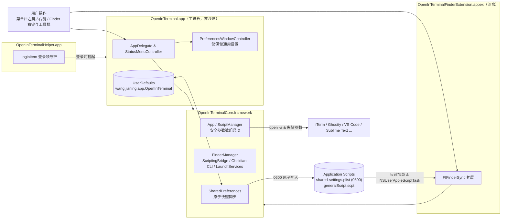

<div align="center">
  
  <h1>OpenInTerminal（极简深度定制版）</h1>
  <p><strong>在 macOS 访达（Finder）中一键直达终端与代码编辑器 —— 适配 macOS 26 / 27、极简设置、开箱即用</strong></p>
  <p>
    <a href="./LICENSE"></a>
    
    
    <a href="https://github.com/Ji4n1ng/OpenInTerminal"></a>
  </p>
  <p>
    <a href="#为什么做这个版本">为什么做这个版本</a> ·
    <a href="#核心能力与深度定制">核心能力</a> ·
    <a href="#架构与工作原理">架构解析</a> ·
    <a href="#支持的应用生态">支持生态</a> ·
    <a href="#安装与使用">安装与构建</a> ·
    <a href="./Resources/README-Config-zh.md">详细配置与排错</a>
  </p>
</div>

> **English TL;DR:** A streamlined, macOS 26+/27-ready fork of [Ji4n1ng/OpenInTerminal](https://github.com/Ji4n1ng/OpenInTerminal) under the **MIT License**. Fixes preference persistence and Finder Sync menu issues on macOS 26/27 without requiring an Apple Developer App Group provisioning profile, trims the Preferences UI down to a clean General-only pane, ships developer-first defaults (`Launch at Login`, `Quick Toggle → Open Terminal`, `iTerm`, `Sublime Text`), and features a redesigned dual-tone circuit maple leaf icon set.

---

## 为什么做这个版本？

对于每天在 macOS 上写代码、查日志、处理项目文件的开发者来说，**「在当前 Finder 目录快速打开终端或编辑器」**是最高频的动作之一。每次打开终端手动 `cd` 或把文件夹拖进窗口，都会打断心流。

[OpenInTerminal](https://github.com/Ji4n1ng/OpenInTerminal) 一直是 macOS 生态中最经典的开源解决方案，但在最新 **macOS 26 / 27** 环境下使用原版 v2.3.9 时，实际体验存在几个明显痛点：

1. **偏好设置重启丢失**：原版依赖 App Group 容器（`group.wang.jianing.app.OpenInTerminal`）在主应用与沙盒 Finder 扩展之间共享配置；在 macOS 26/27 及无付费签名描述文件的本地构建中，`cfprefsd` 会拒绝写入该 Group 容器，导致每次重启应用都重新触发 `First Setup`，所有配置清空。
2. **偏好设置界面偏冗余**：日常 99% 的场景只需要设置默认终端、默认编辑器与菜单栏一键快启，「自定义」「高级」「关于」三个标签页反而增加了理解与视觉负担。
3. **默认配置不够贴合开发者习惯**：首次启动默认是系统自带的 `Terminal` + `TextEdit`，且未开启开机自启与菜单栏左键一键快启，每次初始化都需要手动改一遍。
4. **本地构建与视觉辨识度**：希望拥有更具辨识度的菜单栏彩色图标与应用图标，且在本地无付费开发者账号的情况下依然能稳定签名、持久保存配置并正常注册 Finder 扩展。

本仓库基于上游最新 `oit-001/integration` 分支，针对上述问题进行了深度整合、精简与视觉重塑。

---

## 核心能力与深度定制

### 1. macOS 26 / 27 偏好设置持久化与 Finder 扩展修复
- **去 App Group 化持久化**：主应用改将偏好设置直接写入自身标准域 `wang.jianing.app.OpenInTerminal`，彻底解决 macOS 26 / 27 下重启即触发 `First Setup`、配置无法落盘的问题。
- **沙盒安全快照同步**：主应用启动、修改配置或退出时，会通过原子临时文件（权限严格锁定 `0600`）向 Finder 扩展的 `Application Scripts` 目录发布只读快照 `shared-settings.plist`；沙盒内的 Finder 扩展每次构建右键/工具栏菜单时即时加载最新快照，**无需付费开发者描述文件，也无需「完全磁盘访问权限」**。
- **修复开机自启与 Finder 扩展注册**：移除主应用 `Info.plist` 中误配的 `NSExtension` 字典，修复登录项辅助程序 `OpenInTerminalHelper` 中错误的 `mainAppIdentifier`，并补全侧边栏右键菜单支持。

### 2. 极简主义偏好设置（仅保留「通用」面板）
- 移除了「自定义（Custom）」「高级（Advanced）」「关于（About）」三个标签页，并自动隐藏多余的顶部标签栏工具条。
- 窗口尺寸精确贴合「通用」面板，所有高频选项一屏呈现：
  - 开机自动启动
  - 菜单栏快速启动（左键一键直达，右键呼出菜单）
  - 隐藏状态栏图标 / 隐藏右键菜单项 / 右键菜单归入子菜单
  - 默认终端 & 默认编辑器选择

### 3. 开发者开箱即用默认值
首次启动或重置配置时，无需繁琐调整即可直接进入高效工作流：
- **开机自动启动**：默认开启（并同步调用 `SMLoginItemSetEnabled` 注册系统登录项）
- **菜单栏快速启动**：默认开启，动作默认为「打开终端」（左键点击菜单栏图标即在当前访达目录秒开终端，右键展开完整菜单）
- **默认终端**：`iTerm`
- **默认编辑器**：`Sublime Text`

### 4. 定制视觉图标体系
基于双色电路枫叶圆形徽章（裁切保留外圈圆环与双色电路枫叶主体，去除底部文字，圆环外透明）为三个 macOS 渲染场景分别做了像素级优化：
- **状态栏（菜单栏）图标**：居中圆形白底灰环 + 双色电路枫叶徽章，圆环外透明，提供 `1x / 2x / 3x`（`22 / 44 / 66 px`）彩色透明 PNG，深色/浅色菜单栏均清晰醒目。
- **Finder 工具栏图标**：独立生成的单色模板（Template）圆环与电路枫叶剪影，镂空保留电路纹理与叶脉细节，原生自适应系统深浅色与高亮态。
- **应用图标（`AppIcon.icns`）**：居中圆形双色电路枫叶徽章（白底灰环、圆环外透明），覆盖 `16×16` 至 `1024×1024` 全分辨率。

### 5. 安全加固与现代开发生态支持
- **杜绝路径命令注入**：Finder 沙盒扩展执行 AppleScript 时改用离散参数列表（`argv` + AppleScript `quoted form of` 逐项安全转义），包含空格、引号或特殊符号的文件夹名也能安全打开。
- **LaunchServices 应用发现**：优先通过系统 `LaunchServices` 按 Bundle ID 检测已安装应用（同时兼容 Sublime Text 4 `com.sublimetext.4` 与 Sublime Text 3 `com.sublimetext.3`），不受自定义安装目录或目录读取错误影响，同时自动排除废纸篓、Time Machine 备份与只读 DMG 镜像中的副本。
- **Obsidian 活动笔记联动**：当 Obsidian 处于前台时，支持直接定位当前笔记所在目录打开终端，或用默认编辑器打开当前笔记文件。

---

## 架构与工作原理

`OpenInTerminal` 采用标准的 macOS 多目标协作架构，由 4 个紧密配合的模块组成：



### 路径解析优先级
当你触发「打开终端 / 编辑器 / 复制路径」时，遵循以下确定性顺序：
1. 若最前端应用为 **Obsidian**（且启用了 Obsidian CLI），定位当前活动笔记文件或其所在目录；
2. 否则读取 **Finder** 当前选中的文件或文件夹；
3. 若未选中具体条目，读取最前端 **Finder 窗口** 的当前目录；
4. 若无打开的 Finder 窗口，则优雅回退到当前用户的 **Desktop（桌面）** 目录。

---

## 支持的应用生态

| 分类 | 支持的应用 |
| --- | --- |
| **终端（Terminals）** | iTerm、Terminal、Ghostty、Warp、WezTerm、kitty、Alacritty、Tabby、Hyper、cmux、Kaku、Otty |
| **代码编辑器（Editors）** | Sublime Text、Visual Studio Code、VS Code Insiders、Cursor、Zed、Xcode、Nova、VSCodium、BBEdit、TextMate、CotEditor、Glim、Typora、Obsidian、MacVim、Neovim、Emacs、TextEdit、Atom |
| **JetBrains 全家桶** | IntelliJ IDEA、PyCharm、WebStorm、GoLand、CLion、PhpStorm、RubyMine、AppCode、Fleet、Android Studio（支持 JetBrains Toolbox 目录自动扫描） |
| **Git 客户端** | GitHub Desktop、Fork、GitKraken |

---

## 安装与使用

### 方式一：直接下载 Release（推荐）
1. 前往本仓库 [Releases](https://github.com/biqiufeng/OpenInTerminal/releases) 下载 `OpenInTerminal.zip` 并解压，将 `OpenInTerminal.app` 拖入 `/Applications`。
2. 由于本版本为个人开源 ad-hoc 签名构建，首次启动前请执行以下命令移除 macOS 隔离属性（避免触发「已损坏」提示及 App Translocation 导致 Finder 扩展无法注册）：
   ```bash
   xattr -dr com.apple.quarantine /Applications/OpenInTerminal.app
   ```
3. 启动 `/Applications/OpenInTerminal.app`（首次启动会自动应用默认配置并发布 Finder 扩展脚本）。
4. **macOS 15 / 26 / 27 启用 Finder 右键与工具栏扩展**：
   - 图形界面：`系统设置 → 通用 → 登录项与扩展 → OpenInTerminal Extensions`，开启扩展；
   - 或在终端执行一行命令立即启用：
     ```bash
     pluginkit -a /Applications/OpenInTerminal.app/Contents/PlugIns/OpenInTerminalFinderExtension.appex
     pluginkit -e use -i wang.jianing.app.OpenInTerminal.OpenInTerminalFinderExtension
     ```
5. 首次通过菜单栏打开终端时，系统会弹出自动化控制 Finder 的授权请求，点击「允许」即可。

### 方式二：从源码本地构建

#### 使用完整 Xcode（推荐）
无需 Apple Developer 账号即可构建本地可运行的 ad-hoc 签名版本：
```bash
./build-unsigned.sh
```
构建产物位于 `./export/OpenInTerminal.app`，复制到 `/Applications` 并按上方步骤启用即可。

#### 运行偏好设置持久化回归测试
无需 Xcode，仅需 Xcode Command Line Tools 即可运行：
```bash
Tests/SharedPreferences/run.sh
```

更多细节（Obsidian CLI 联动、Neovim/Kitty 自定义启动命令、SIP/AMFI 权限排查等）请查阅 [详细配置与常见问题文档](./Resources/README-Config-zh.md)。

---

## 开源协议与致谢

本项目遵循 **[MIT License](./LICENSE)** 开源，你可以自由使用、修改、分发和二次定制。

- 衷心感谢原项目 **[Ji4n1ng/OpenInTerminal](https://github.com/Ji4n1ng/OpenInTerminal)**（Copyright © 2019 Jianing Wang）及所有上游贡献者（特别是 macOS 26+/27 共享偏好设置修复与安全加固 PR 的贡献者），本项目基于其 MIT 开源代码构建并保留完整上游提交历史与版权声明。
- 全局快捷键组件基于 [Kentzo/ShortcutRecorder](https://github.com/Kentzo/ShortcutRecorder)。
